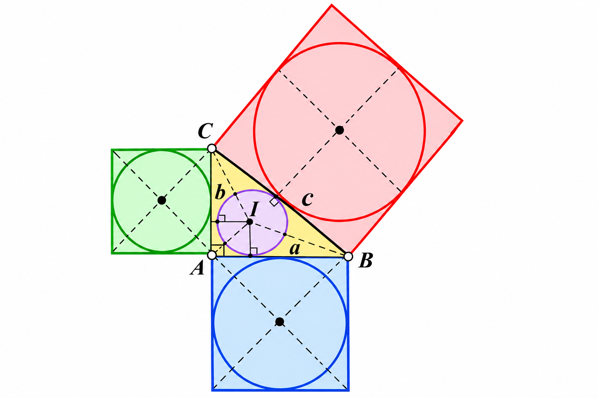

# PTH-004 — Окружности на сторонах и вписанная окружность (`PYTHAGOREAN FAMILY`)

- **ID:** `PTH-004` *(также упоминается в заметках как конструкция `PAT-29` / `INSIGHT-GEO-001`)*
- **Название:** Четыре окружности прямоугольного треугольника: окружности в квадратах на сторонах и вписанная окружность
- **Категория:** `Mathematical Relations`
- **Статус достоверности:** `DERIVED` — строго выведено из формулы радиуса вписанной окружности прямоугольного треугольника и площадей кругов (связано с конструкцией Пифагора)

---

## 1. ID и название

`PTH-004` — пример преобразования линейного инварианта прямоугольного треугольника ($a + b = c + 2r$) в радикальное соотношение через квадратные корни площадей четырёх окружностей.

---

## 2. Исходная математическая идея

Квадратный корень площади круга пропорционален его радиусу ($\sqrt{\pi R^2} = \sqrt{\pi}\,R$). Поэтому линейное соотношение между сторонами прямоугольного треугольника и радиусом его вписанной окружности ($a + b = c + 2r$) превращается в точное равенство сумм квадратных корней площадей четырёх окружностей: вписанных в квадраты на сторонах и вписанной в сам треугольник.

---

## 3. Формулы

**Основное соотношение (в единых обозначениях площадей $A, B, C, D$):**

$$\sqrt{C} + \sqrt{D} = \sqrt{A} + \sqrt{B}$$

**Определяющие площади четырёх конкретных окружностей и радиус вписанной окружности:**

$$A = \frac{\pi a^2}{4}, \qquad B = \frac{\pi b^2}{4}, \qquad C = \frac{\pi c^2}{4}, \qquad D = \pi r^2, \qquad r = \frac{a + b - c}{2}$$

---

## 4. Геометрическая или алгебраическая интерпретация



- **В центре:** прямоугольный треугольник с катетами $a, b$ и гипотенузой $c$ (на чертеже прямой угол при вершине $A$, горизонтальный катет $AB = a$, вертикальный катет $AC = b$, гипотенуза $BC = c$, центр вписанной окружности $I$).
- **Четыре окружности (площади $A, B, C, D$):**
  - $A$ — площадь окружности, вписанной в квадрат на катете $a$ (диаметр $a$, радиус $a/2$);
  - $B$ — площадь окружности, вписанной в квадрат на катете $b$ (диаметр $b$, радиус $b/2$);
  - $C$ — площадь окружности, вписанной в квадрат на гипотенузе $c$ (диаметр $c$, радиус $c/2$);
  - $D$ — площадь окружности радиуса $r$, вписанной внутрь самого треугольника.

> **Важно о нотации для ИИ-агента:** на геометрическом чертеже буквы $A, B, C$ традиционно обозначают *вершины* треугольника, тогда как в формуле $\sqrt{C} + \sqrt{D} = \sqrt{A} + \sqrt{B}$ символы $A, B, C, D$ обозначают *площади четырёх кругов*. При разборе текста агент обязан различать эти две роли символов.

---

## 5. Доказательство либо ссылка на обоснование

Для любого прямоугольного треугольника ($a, b, c > 0$, $a^2 + b^2 = c^2$):

1. Извлекаем неотрицательные квадратные корни из площадей четырёх кругов:
   $$\sqrt{A} = \sqrt{\frac{\pi a^2}{4}} = \frac{\sqrt{\pi}}{2}a$$
   $$\sqrt{B} = \sqrt{\frac{\pi b^2}{4}} = \frac{\sqrt{\pi}}{2}b$$
   $$\sqrt{C} = \sqrt{\frac{\pi c^2}{4}} = \frac{\sqrt{\pi}}{2}c$$
   $$\sqrt{D} = \sqrt{\pi r^2} = \sqrt{\pi}\,r$$

2. Используем классическую формулу радиуса вписанной окружности прямоугольного треугольника (из равенства отрезков касательных от вершин до точек касания и квадрата $r \times r$ при прямом угле):
   $$r = \frac{a + b - c}{2} \iff c + 2r = a + b$$

3. Умножаем обе части равенства $c + 2r = a + b$ на $\frac{\sqrt{\pi}}{2}$:
   $$\frac{\sqrt{\pi}}{2}c + \sqrt{\pi}\,r = \frac{\sqrt{\pi}}{2}a + \frac{\sqrt{\pi}}{2}b$$
   $$\sqrt{C} + \sqrt{D} = \sqrt{A} + \sqrt{B}$$

**Исследовательский статус результата:** это **не** независимая новая теорема, а алгебраически эквивалентная переформулировка соотношения $r = \frac{a+b-c}{2}$ в терминах площадей четырёх окружностей (вместе с квадратичным законом $A + B = C$ из [`PTH-003`](./PTH-003.md), следующим из $a^2 + b^2 = c^2$).

---

## 6. Условия применимости

- Исходный треугольник является **невырожденным прямоугольным треугольником** в евклидовой плоскости ($a^2 + b^2 = c^2$): все три стороны строго положительны ($a > 0, b > 0, c > 0$), оба катета ненулевые.
- Символы $A, B, C, D$ **не являются произвольными независимыми переменными**, а строго заданы как площади четырёх конкретных окружностей:
  - $A$ — площадь окружности, вписанной в квадрат на катете $a$ (диаметр $a$);
  - $B$ — площадь окружности, вписанной в квадрат на катете $b$ (диаметр $b$);
  - $C$ — площадь окружности, вписанной в квадрат на гипотенузе $c$ (диаметр $c$);
  - $D$ — площадь окружности радиуса $r$, вписанной в сам треугольник.
- Значения квадратных корней — главные вещественные ($\ge 0$, с учётом $A, B, C, D > 0$).

---

## 7. Примеры

### Контрольный пример: треугольник **$3\text{–}4\text{–}5$** ($a = 3, b = 4, c = 5$)

1. Проверка гипотенузы: $3^2 + 4^2 = 9 + 16 = 25 = 5^2$.
2. Радиус вписанной окружности:
   $$r = \frac{3 + 4 - 5}{2} = 1$$
3. Площади и квадратные корни площадей:

| Окружность | Конструкция | Площадь | Квадратный корень площади |
| :--- | :--- | :--- | :--- |
| $A$ | в квадрате на катете $a=3$ | $\frac{9\pi}{4} \approx 7.069$ | $\frac{3\sqrt{\pi}}{2} \approx 2.659$ |
| $B$ | в квадрате на катете $b=4$ | $4\pi \approx 12.566$ | $2\sqrt{\pi} \approx 3.545$ |
| $C$ | в квадрате на гипотенузе $c=5$ | $\frac{25\pi}{4} \approx 19.635$ | $\frac{5\sqrt{\pi}}{2} \approx 4.431$ |
| $D$ | вписанная в треугольник ($r=1$) | $\pi \approx 3.142$ | $\sqrt{\pi} \approx 1.772$ |

4. Проверка равенства $\sqrt{C} + \sqrt{D} = \sqrt{A} + \sqrt{B}$:
   - Точная проверка:
     $$\frac{5\sqrt{\pi}}{2} + \sqrt{\pi} = \frac{7\sqrt{\pi}}{2}, \qquad \frac{3\sqrt{\pi}}{2} + 2\sqrt{\pi} = \frac{7\sqrt{\pi}}{2} \quad (\text{PASS})$$
   - Численная проверка:
     $$4.431 + 1.772 = 6.203 = 2.659 + 3.545 \quad (\text{PASS})$$

---

## 8. Известные ограничения

- **Нарушается при замене фигур или масштаба:** если вместо кругов взять, например, квадраты или равносторонние треугольники с тем же радиусом вписанной окружности, формула теряет коэффициент $\sqrt{\pi}/2$ у диаметров против $\sqrt{\pi}$ у радиуса, либо требует пересчёта множителя.
- **Нарушается в непрямоугольном треугольнике:** для произвольного треугольника формула $r = \frac{a+b-c}{2}$ неверна ($r = \frac{S_{\triangle}}{p}$), поэтому равенство $\sqrt{C} + \sqrt{D} = \sqrt{A} + \sqrt{B}$ не выполняется.
- **Опасность ложной геометризации:** абстрактная запись $\sqrt{C} + \sqrt{D} = \sqrt{A} + \sqrt{B}$ без определений $A, B, C, D$ является чисто алгебраическим уравнением над четырьмя неотрицательными переменными.

---

## 9. Статус проверки и связи

- **Mathematical Verification:** `DERIVED` (строгий алгебро-геометрический вывод из $r = \frac{a+b-c}{2}$ и $S = \pi R^2$, подтверждён численно на $3\text{–}4\text{–}5$).
- **`Mathematical equivalence` (при определениях $A, B, C, D$ из раздела 3 и условиях раздела 6):**
  - Эквивалентно линейному соотношению $a + b = c + 2r \iff r = \frac{a+b-c}{2}$.
  - Дополняет квадратичное равенство [`PTH-003`](./PTH-003.md) ($A + B = C \iff a^2 + b^2 = c^2$).
  - Вместе с $A + B = C$ (т.е. $a^2 + b^2 = c^2$, [`PTH-001`](./PTH-001.md)) однозначно связывает площади всех четырёх окружностей с невырожденным прямоугольным треугольником.
- **`Structural analogy` (НЕ доказательство):**
  - Визуально похоже на аддитивные законы вида $\sqrt{x} + \sqrt{y} = \sqrt{u} + \sqrt{v}$, которые без определений $A, B, C, D$ как площадей четырёх указанных окружностей теряют связь с геометрией.

---

## 10. Связанные паспорта UMFP и польза для агента

**UMFP Passport Reproducibility:** фактические результаты `generatePassport` в **UMFP `0.1.x`** *(детерминированные паспорта записи, не являющиеся математическим доказательством теоремы)*:

1. Для `\sqrt{C} + \sqrt{D} = \sqrt{A} + \sqrt{B}`:
```json
{
  "parseStatus": "parsed",
  "structuralId": "UMFP.STR.ALG.C1CDC4",
  "logicalClassId": "UMFP.LC.EQUATION_RELATION.5476",
  "structuralConstructs": { "RADICAL": 4 },
  "logicalOrganizations": ["EQUATION_RELATION", "RADICAL_DEPENDENCE"],
  "domains": ["ALGEBRA"],
  "domainClassification": {
    "primaryDomain": "ALGEBRA",
    "confidence": "high",
    "classificationMethod": "structural_rules"
  },
  "freeVariables": ["A", "B", "C", "D"],
  "constraints": [
    "C >= 0 [domain_dependent]",
    "D >= 0 [domain_dependent]",
    "A >= 0 [domain_dependent]",
    "B >= 0 [domain_dependent]"
  ]
}
```

2. Для `r = \frac{a + b - c}{2}`:
```json
{
  "parseStatus": "parsed",
  "structuralId": "UMFP.STR.ALG.2678A8",
  "logicalClassId": "UMFP.LC.EQUATION_RELATION.5089",
  "structuralConstructs": { "FRACTION": 1 },
  "logicalOrganizations": ["EQUATION_RELATION", "RATIONAL_EXPRESSION"],
  "domains": ["ALGEBRA"],
  "freeVariables": ["a", "b", "c", "r"],
  "constraints": ["2 != 0 [required]"]
}
```

**Польза для ИИ-агента:**
1. UMFP даёт честный алгебраический паспорт: 4 радикала (`RADICAL: 4`), уравнение (`EQUATION_RELATION`), ограничения неотрицательности `A, B, C, D >= 0` и домен `ALGEBRA`.
2. Сопоставляя паспорт с `PTH-004` в Insight Bank, агент получает интеллектуальный ориентир:
   - если по контексту $A, B, C, D$ являются **площадями**, квадратные корни $\sqrt{\cdot}$ переводят квадратичные величины (площади) обратно в линейные масштабы (диаметры/радиусы);
   - стоит проверить, не описывает ли задача **прямоугольный треугольник** с тремя окружностями на сторонах и одной вписанной окружностью, и не сводится ли выражение к $a + b = c + 2r$.
3. При этом агент обязан помнить: этот ориентир является гипотезой для проверки по тексту задачи, а не заменой детерминированного паспорта UMFP.
